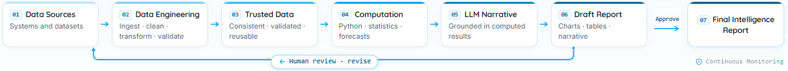

## Reliable AI Architecture  

This repository brings together applied work on **Autonomous Data-to-Narrative Engine,autonomous agents, human–AI governance, semantic retrieval, local AI workflows**.

The unifying question is not simply how to make an AI model perform a task. It is:

> How should an AI-enabled system be organized so that agents can execute work reliably while authority, oversight, and accountability remain clear?
 

## 1. Autonomous Data-to-Narrative Engine · Agentic • Repeatable • Reusable

I wanted to test a different question:

> Can agents carry an entire workflow without human handoffs between tools?

So I built an early self-driving workflow that connects data ingestion, engineering, validation, analytical computation and local LLM-generated narratives to produce a draft intelligence report.

 

[**Output**](https://panxiaoyan225-sudo.github.io/AI-DataSuite/Data-to-Narrative-Pipelines/Data-to-Narrative_walkthrough.html) — Generated charts, validation checks and analytical narratives.  
[**Draft Report**](https://panxiaoyan225-sudo.github.io/AI-DataSuite/Data-to-Narrative-Pipelines/Executive_Expense_Report_2026-11-26.html) — First end-to-end report, ready for human review and refinement.

**Building this changed how I see the future of work.**  
A report today usually passes through several tools and several people. If a system can carry that whole chain reliably, much of that routine work will change. I'd rather say that plainly than avoid it.  
But agents can also misread data and make mistakes without noticing. Someone still has to define the problem, check the assumptions, and correct the work.

**Let agents drive the workflow. Keep human judgment. Deliver trusted intelligence.**

## 2. Autonomous agents and orchestration

The repository includes work with **OpenClaw** and multi-agent workflows. The architecture explores how distinct agents can carry out assigned responsibilities, coordinate through an orchestration layer, and return work for human review.

The emphasis is on more than agent execution:

- Defined responsibilities and operating boundaries.
- Coordination across agents and task stages.
- Human supervision and decision authority.
- Clear handling of outputs that require review.

See the [Governed Agentic System](https://xiaoyanpan.com/#governed-agentic-system) for the broader architecture.

## 3. Reliable Human–AI Operating System

The operating-system framework extends beyond individual prompts or agents. It organizes the conditions under which AI work should be performed:

- **Mandate:** what the agent is authorized to do.
- **Knowledge:** what information and evidence it may use.
- **Method:** how the task should be approached.
- **Test:** how the result should be evaluated.
- **Supervision:** when human review or intervention is required.

The central principle is:

> AI can execute work. Only humans can own the consequences.

[Explore the Reliable Human–AI Operating System](https://xiaoyanpan.com/Reliable_Human_AI_Operating_System_Arch.html)

## 4. Knowledge retrieval and semantic intelligence

The repository also contains the technical building blocks used by knowledge-oriented AI workflows:

| Capability | Implementation |
|---|---|
| Local embeddings | `Local_Embeddings.py` with `all-MiniLM-L6-v2` |
| Vector similarity | NumPy-based cosine similarity |
| Text segmentation | Recursive character-based chunking |
| Persistent vector storage | ChromaDB |
| Local RAG | LangChain with Ollama |
| Semantic search | Embedding-based document retrieval |

These components support local semantic search and retrieval-augmented generation. They are related to, but distinct from, the more focused  **Custom Agentic_RAG_Pipeline** which demonstrates retrieval planning, source prioritization, and evidence evaluation in one end-to-end workflow. Explore the Architecture of [Custom Agentic RAG ](https://github.com/panxiaoyan225-sudo/Agentic_RAG_Pipeline) .
## 5. Additional applied AI modules

The repository includes smaller applications that explore other ways AI can support information work:

- **NLP and text analysis:** sentiment analysis and text classification using Hugging Face Transformers.
- **Financial applications:** a Streamlit stock-analysis application using LSTM, and a Gemini function-calling agent that retrieves market information through `yfinance`.
- **Speech processing:** speech-to-text transcription using Whisper and text-to-speech using gTTS.
- **Travel search:** a flight-search application that compares retrieved flight options.

These are supporting experiments and applications within the broader AI/data work; they are not presented as one integrated production platform.

## Technical components

- **Languages:** Python, HTML/CSS
- **Agent orchestration:** OpenClaw
- **Local model and retrieval tools:** Ollama, LangChain, ChromaDB
- **Embeddings and NLP:** Sentence Transformers, Hugging Face Transformers
- **AI services:** Google GenAI
- **Data and modelling:** NumPy, pandas, scikit-learn, PyTorch, yfinance
- **Development and deployment:** Docker, Windows/WSL2, GitHub Actions

## How this repository fits the broader direction

The projects in this repository explore the operating layer of an intelligence system: **how agents are organized, what knowledge they can access, how analytical results are produced and communicated, how their work is evaluated, and where human authority remains**.

The related projects address complementary parts of that direction:

- [Agentic RAG Pipeline](https://github.com/panxiaoyan225-sudo/Agentic_RAG_Pipeline): how an agent retrieves and evaluates knowledge.
- [Reliable Human–AI Operating System](https://xiaoyanpan.com/Reliable_Human_AI_Operating_System_Arch.html): How make agents useful and reliable. 
- [Data-Driven Foresight](https://github.com/panxiaoyan225-sudo/Data-Driven-Foresight): how longitudinal data becomes forward-looking analytical intelligence.
- [Data Pipelines](https://github.com/panxiaoyan225-sudo/Data-Pipelines): how data workflows are ingested, validated, and automated.

**The objective is not autonomy without limits. It is useful autonomy within a reliable human-defined operating model.**
