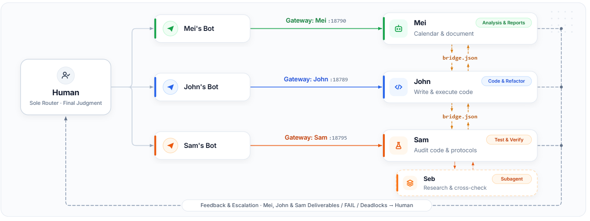

## Reliable AI Systems & Architecture

This repository brings together applied work on **Autonomous Data-to-Narrative Engine,autonomous agents, human–AI governance, semantic retrieval, local AI workflows**.

The unifying question is not simply how to make an AI model perform a task. It is:

> How should an AI-enabled system be organized so that agents can execute work reliably while authority, oversight, and accountability remain clear?

The work connects agent orchestration with the knowledge, analytical methods, and operating rules required for dependable use.

[**Governed Agentic System**](https://xiaoyanpan.com/#governed-agentic-system) · [**Reliable Human–AI Operating System**](https://xiaoyanpan.com/Reliable_Human_AI_Operating_System_Arch.html)

## 1. Autonomous Data-to-Narrative Engine : Agentic • Repeatable • Reusable
i buil this self-driving system that can carry an analytical workflow from source data to a finished intelligence report. This is more than automating a report-writing task. It is automating the production of analytical intelligence - integrating data ingestion, cleaning, transformation and validation to establish a trusted data foundation, followed by deterministic analytical computation and local LLM-generated narratives.  

**The result is a repeatable and reusable autonomous workflow that connects Raw data source, with automated Data Engineering,analytical intelligence and automated reporting, zero manual intervention.**  
`Source Data → Automated Data Engineering → Trusted Data Foundation → Analytical Computation → LLM-Generated Narrative → Automated Reporting`

[**Data-to-Narrative_walkthrough.html**](https://panxiaoyan225-sudo.github.io/AI-DataSuite/Data-to-Narrative-Pipelines/Data-to-Narrative_walkthrough.html) — Rendered, output-only walkthrough showcasing all generated charts, audit checks, and executive narratives (open locally in your browser or via GitHub Pages).  
[**Executive_Expense_Report**](https://panxiaoyan225-sudo.github.io/AI-DataSuite/Data-to-Narrative-Pipelines/Executive_Expense_Report_2026-11-26.html) - Production-ready executive brief generated end-to-end by the Autonomous Data-to-Narrative Engine.

Two complementary architectural approaches are considered.  
### 1.1 Compute-Then-Communicate

**Deterministic computation first. LLM-generated narrative second.**

This pipeline separates analytical computation from language generation. Python performs the calculations, while a local LLM communicates the resulting insights in a professional, structured narrative. 

**Pipeline flow**

`Trusted Data Foundation → Python Computation → Structured Summary → Local LLM → Narrative Output`

**Stage 1 — Compute (Python)**

Using pandas, scikit-learn, and supporting Python libraries, the pipeline performs:

- Data loading, cleaning, and validation.
- Aggregations, rankings, and trend analysis.
- Year-over-year changes and comparisons.
- Domestic and international segmentation.
- Clustering and peer-group analysis.
- Chart generation and structured analytical summaries.

**Stage 2 — Communicate (Local LLM)**

The structured summary is passed to a local language model through Ollama (for example, `llama3.1:latest`).

The LLM generates a professional narrative based on the computed findings. It is instructed to remain grounded in the supplied results rather than inventing figures or unsupported trends.

**Stage 3 — Generate Artifacts**

The pipeline organizes its outputs into reusable analytical and reporting artifacts:

| Output location | Contents |
|---|---|
| `{BASE_DIR}/results/` | Charts, structured summaries, narrative text, cleaned datasets, and aggregation tables |
| `{BASE_DIR}/reports/` | Excel reports with raw data, dimension and fact tables, aggregations, key metrics, and charts |

PowerPoint reporting can also be generated as an optional extension.

**Data and accuracy boundaries**

- Raw data rows are processed by Python and are not sent to the LLM.
- The LLM receives structured analytical summaries rather than the underlying dataset.
- Numerical computation remains in Python, where results can be reproduced and checked.
- The narrative must be grounded in the supplied analytical results.
- If the local LLM is unavailable, the pipeline can save a local fallback narrative.

The separation of computation and communication helps keep numerical analysis reproducible while using the LLM for interpretation and presentation. Narrative validation remains an important additional safeguard.

### 1.2 Direct LLM-to-DB (Text-to-SQL)

**Natural-language questions translated into database queries.**

A different approach allows an LLM to translate a user's analytical question into SQL, which is then executed against a database.

`User Question → LLM-generated SQL → Database Execution → Query Results → Narrative Response`

Rather than preparing a fixed set of analytical summaries in advance, this architecture supports more flexible, question-driven analysis.

Its main characteristics include:

- Natural-language access to structured database information.
- SQL generation based on database schemas and defined relationships.
- Runtime query execution against approved data sources.
- Narrative responses based on returned query results.

**Governance and accuracy considerations**

Direct LLM-to-DB introduces different risks from compute-first processing. Generated SQL may contain incorrect joins, unsuitable filters, or expensive queries. Query results may also expose information that should not be available to the model.

A governed implementation should therefore include:

- Read-only database access and approved views.
- Defined table, column, and query permissions.
- SQL validation and execution limits.
- Query execution feedback and controlled retries.
- Result validation before narrative generation.
- Human review where the output affects important decisions.

A semantic layer can further constrain queries to governed metrics and approved business definitions instead of exposing unrestricted access to raw tables.

### 1.3 Choosing the Right Architecture

The two approaches address different analytical needs:

| Dimension | Compute-Then-Communicate | Direct LLM-to-DB |
|---|---|---|
| Primary purpose | Repeatable analytical reporting | Flexible, ad-hoc questions |
| Computation | Python and analytical libraries | Database executes generated SQL |
| Timing | Pre-computed before narrative generation | Computed at query time |
| LLM input | Structured analytical summaries | Schema and query results, subject to controls |
| Reproducibility | High for deterministic computations | Depends on query, data state, and execution |
| Main risk | Missing insights in the prepared summary | Incorrect SQL, joins, or data exposure |
| Key safeguards | Data validation and narrative cross-checks | Governed access, SQL validation, and result checks |

**Hybrid direction**

These approaches can also be combined. A governed semantic layer can provide approved metrics and database views, while compute-first processing handles recurring analytical reports. Question-driven queries can then support additional exploration where needed.

The architectural choice should follow the analytical requirement, data sensitivity, and level of control required.

## 2. Autonomous agents and orchestration

The repository includes work with **OpenClaw** and multi-agent workflows. The architecture explores how distinct agents can carry out assigned responsibilities, coordinate through an orchestration layer, and return work for human review.

The emphasis is on more than agent execution:

- Defined responsibilities and operating boundaries.
- Coordination across agents and task stages.
- Human supervision and decision authority.
- Clear handling of outputs that require review.

See the [Governed Agentic System](https://xiaoyanpan.com/#governed-agentic-system) for the broader architecture.

## 3. Reliable Human–AI Operating System

The operating-system framework extends beyond individual prompts or agents. It organizes the conditions under which AI work should be performed:

- **Mandate:** what the agent is authorized to do.
- **Knowledge:** what information and evidence it may use.
- **Method:** how the task should be approached.
- **Test:** how the result should be evaluated.
- **Supervision:** when human review or intervention is required.

The central principle is:

> AI can execute work. Only humans can own the consequences.

[Explore the Reliable Human–AI Operating System](https://xiaoyanpan.com/Reliable_Human_AI_Operating_System_Arch.html)

## 4. Knowledge retrieval and semantic intelligence

The repository also contains the technical building blocks used by knowledge-oriented AI workflows:

| Capability | Implementation |
|---|---|
| Local embeddings | `Local_Embeddings.py` with `all-MiniLM-L6-v2` |
| Vector similarity | NumPy-based cosine similarity |
| Text segmentation | Recursive character-based chunking |
| Persistent vector storage | ChromaDB |
| Local RAG | LangChain with Ollama |
| Semantic search | Embedding-based document retrieval |

These components support local semantic search and retrieval-augmented generation. They are related to, but distinct from, the more focused  **Custom Agentic_RAG_Pipeline** which demonstrates retrieval planning, source prioritization, and evidence evaluation in one end-to-end workflow. Explore the Architecture of [Custom Agentic RAG ](https://github.com/panxiaoyan225-sudo/Agentic_RAG_Pipeline) .
## 5. Additional applied AI modules

The repository includes smaller applications that explore other ways AI can support information work:

- **NLP and text analysis:** sentiment analysis and text classification using Hugging Face Transformers.
- **Financial applications:** a Streamlit stock-analysis application using LSTM, and a Gemini function-calling agent that retrieves market information through `yfinance`.
- **Speech processing:** speech-to-text transcription using Whisper and text-to-speech using gTTS.
- **Travel search:** a flight-search application that compares retrieved flight options.

These are supporting experiments and applications within the broader AI/data work; they are not presented as one integrated production platform.

## Technical components

- **Languages:** Python, HTML/CSS
- **Agent orchestration:** OpenClaw
- **Local model and retrieval tools:** Ollama, LangChain, ChromaDB
- **Embeddings and NLP:** Sentence Transformers, Hugging Face Transformers
- **AI services:** Google GenAI
- **Data and modelling:** NumPy, pandas, scikit-learn, PyTorch, yfinance
- **Development and deployment:** Docker, Windows/WSL2, GitHub Actions

## How this repository fits the broader direction

The projects in this repository explore the operating layer of an intelligence system: **how agents are organized, what knowledge they can access, how analytical results are produced and communicated, how their work is evaluated, and where human authority remains**.

The related projects address complementary parts of that direction:

- [Agentic RAG Pipeline](https://github.com/panxiaoyan225-sudo/Agentic_RAG_Pipeline): how an agent retrieves and evaluates knowledge.
- [Data-Driven Foresight](https://github.com/panxiaoyan225-sudo/Data-Driven-Foresight): how longitudinal data becomes forward-looking analytical intelligence.
- [Data Pipelines](https://github.com/panxiaoyan225-sudo/Data-Pipelines): how data workflows are ingested, validated, and automated.

**The objective is not autonomy without limits. It is useful autonomy within a reliable human-defined operating model.**